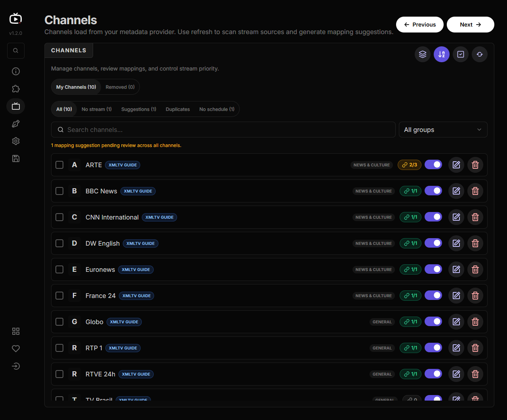
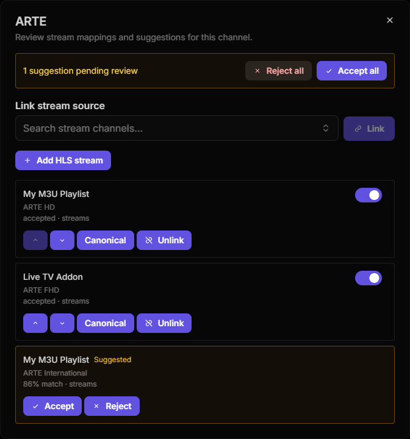

<p align="center">
  
</p>

<h1 align="center">AIOLiveTV</h1>

<p align="center">
  <strong>Your live TV sources, together in Stremio.</strong>
  <br />
  Combine playlists, TV guides and live addons. Review your channels, choose your streams, and watch with or without EPG.
</p>

<p align="center">
  <a href="https://github.com/mrcanelas/aiolivetv/actions/workflows/deploy-docker.yml"></a>
  <a href="https://github.com/mrcanelas/aiolivetv/releases/latest"></a>
  <a href="https://hub.docker.com/r/mrcanelas/aiolivetv"></a>
  <a href="LICENSE"></a>
  <a href="https://discord.gg/UCDWPuRYE"></a>
</p>

<p align="center">
  <a href="https://mrcanelas.github.io/aiolivetv/">Documentation</a> ·
  <a href="#getting-started">Getting started</a> ·
  <a href="#supported-sources">Sources</a> ·
  <a href="#self-hosting">Self-hosting</a> ·
  <a href="#support-the-project">Support the project</a>
</p>

## What is AIOLiveTV?

AIOLiveTV is an open-source Live TV aggregator for [Stremio](https://www.stremio.com/), adapted from [AIOStreams](https://github.com/Viren070/AIOStreams). It brings channels, programme guides and streams from different providers into one configurable addon.

Use an XMLTV guide with your M3U playlist, connect an Xtream or TVHeadend server, add regional guide providers, or combine community Live TV addons. Then use **Channels** to link the right streams, review suggestions and set their priority.

A programme guide is optional. You can start with a playlist and add EPG later.

## What you can do

- **Combine live sources.** Add M3U, XMLTV, Xtream Codes, TVHeadend, Pluto TV and external Stremio addons through the same Addons page. Select catalog, metadata and stream resources independently.
- **Organize your channels.** Search, filter and group channels; change their name, artwork or group; enable, disable or remove them; and review duplicate names and missing streams.
- **Review automatic matching.** Match by `tvg-id`, normalized names, aliases and supporting metadata. High-confidence results are linked automatically; weaker results stay available for review. Channel numbers and timeshift variants such as `+1` remain distinct when matching names.
- **Keep multiple stream choices.** Link several entries from the same addon or from different providers to one channel. Reorder them, accept or reject suggestions, or add a manual HLS URL with headers and stream metadata.
- **Use a guide when available.** Browse programme metadata and schedules from supported EPG sources. Adjust programme times with the source's EPG Time Shift option.
- **Customize stream presentation.** Choose a formatter preset or create a custom format using live channel, source, quality, language and programme information when available.
- **Use other players too.** Export a saved configuration as an M3U playlist and XMLTV guide for Jellyfin and compatible IPTV players.
- **Keep control of your configuration.** Changes remain in your draft until **Save**. Back up your settings as JSON and return later with your configuration UUID and password.

## A look at the configurator

Review stream counts, pending suggestions, groups and channel visibility from one screen.



<details>
<summary><strong>Inside a channel: stream priority, manual links and suggestions</strong></summary>

Each channel can have multiple accepted streams and suggestions waiting for review. Use the controls to change priority, link another source or add a manual HLS stream.



</details>

<sub>Captures of the AIOLiveTV interface using illustrative channel and mapping data. The examples do not represent a bundled playlist, a provider account or a subscription.</sub>

## With or without EPG

| Configuration                    | What you get                                                                                                                                                                         |
| -------------------------------- | ------------------------------------------------------------------------------------------------------------------------------------------------------------------------------------ |
| **With a valid programme guide** | Guide-backed channels, programme metadata and schedules, with streams linked from your playback sources. Native EPG is advertised when the configuration has verified guide support. |
| **Without a programme guide**    | Channels and streams from playlists and Live TV addons, available through the normal Stremio catalog. You can still review mappings and combine stream choices.                      |

Native EPG requires a Stremio client that supports it. Adding an M3U playlist alone does **not** enable Native EPG. The standard `catalog`, `meta` and `stream` resources remain the basis of playback.

## Supported sources

Sources are configured as addons in **Addons**, under **Streams** or **Metadata & Catalogs**. Their role depends on the resources you enable.

| Source                               | What it provides                                                                                                                                      |
| ------------------------------------ | ----------------------------------------------------------------------------------------------------------------------------------------------------- |
| **M3U**                              | Playlist channels and streams, including `tvg-id` and channel metadata when supplied. Can also be used as a stream-only source for an existing guide. |
| **XMLTV**                            | Channel definitions, programme metadata and EPG from `.xml` or `.xml.gz` guides. Pair it with a playback source.                                      |
| **Xtream Codes**                     | Live channels and streams, plus EPG when available from the provider. Includes category filtering.                                                    |
| **TVHeadend**                        | Channels, EPG and live playback through its HTTP API. Supports direct playback and an optional instance-controlled proxy.                             |
| **Pluto TV**                         | Regional Live TV catalogs and streams using community M3U/XMLTV sources. Playback availability depends on the stream's region.                        |
| **TDTChannels**                      | Spanish channels and streams, with an XMLTV guide when available.                                                                                     |
| **Vivo TV / Claro TV+**              | Brazilian channel listings and programme guides.                                                                                                      |
| **Movistar / Mi.tv**                 | Regional channel listings and programme guides for supported Latin American countries.                                                                |
| **Orange TV / Movistar Plus+ Spain** | Spanish channel listings and detailed programme guides.                                                                                               |
| **TVP / DIRECTV**                    | Guide metadata for Poland and the United States, respectively.                                                                                        |
| **Community Live TV addons**         | Presets for RTVE, FrostView, Fenix TV, USA TV, Argentina TV and Debridio TV, plus custom Stremio manifest URLs.                                       |

**Guide-only providers do not supply subscription streams.** Pair their channels with an M3U playlist, Xtream account or another playback source you can access. Providers may also be limited by geography or the instance administrator's settings.

See the [source configuration guide](https://mrcanelas.github.io/aiolivetv/guides/sources) for options, provider requirements and connectivity details.

## Getting started

1. **Run an instance** using one of the [self-hosting options](#self-hosting), then open `/stremio/configure`.
2. **Add your sources** on **Addons**. For a separate guide and playlist, add XMLTV with **Catalog + Meta** and M3U with **Stream**. For a playlist-only setup, keep M3U's default **Catalog + Meta + Stream** resources.
3. **Review Channels.** Check the automatic mappings, resolve suggestions, choose the channels you want, and arrange their stream priority. Sources contributing their own channels and streams already bind those entries by ID.
4. **Choose a formatter** if you want to customize how stream choices appear in Stremio.
5. **Save & Install.** Create or update your configuration, keep its UUID and password, then install it in Stremio or copy the manifest URL to another device.

When you make changes later, save the same configuration to update what clients receive. If another source repeats channels already supplied by your guide, enable only its **Stream** resource to avoid duplicate listings.

Full walkthrough: [Setup](https://mrcanelas.github.io/aiolivetv/configuration/setup) · [Channels](https://mrcanelas.github.io/aiolivetv/guides/channels) · [Formatter reference](https://mrcanelas.github.io/aiolivetv/reference/custom-formatter)

### Jellyfin and other IPTV players

After saving, open **Save & Install → Jellyfin & Other Players** to get your M3U playlist and XMLTV guide URLs. In Jellyfin, add them as an **M3U Tuner** and an **XMLTV** guide provider.

Exports use revocable token-based links and reflect your **saved** channels, mappings and priorities. Keep these links private. Redirect playback is the default; proxying video requires the instance administrator to enable it.

See [Export to Jellyfin](https://mrcanelas.github.io/aiolivetv/guides/jellyfin) for setup, network requirements and limitations. AIOLiveTV exports Live TV data; it does not manage Jellyfin recordings or transcode video.

## Self-hosting

### Docker Compose

The included [`compose.yaml`](compose.yaml) builds AIOLiveTV from this repository and persists its data in `./data`.

```bash
git clone https://github.com/mrcanelas/aiolivetv.git
cd aiolivetv
cp .env.sample .env
```

Edit `.env` before starting:

```dotenv
BASE_URL=http://localhost:3000
SECRET_KEY=<your-64-character-hex-key>
DATABASE_URI=sqlite://./data/db.sqlite
```

Generate the key with `openssl rand -hex 32`, then paste it into `.env`. Keep it unchanged across restarts and upgrades so existing encrypted configurations remain readable.

```bash
docker compose up -d --build
```

Open [http://localhost:3000/stremio/configure](http://localhost:3000/stremio/configure). For a remote instance, set `BASE_URL` to its public HTTPS address and configure a reverse proxy as described in the [deployment guide](https://mrcanelas.github.io/aiolivetv/getting-started/deployment).

Prebuilt release images are also published to **`ghcr.io/mrcanelas/aiolivetv:latest`** and [Docker Hub](https://hub.docker.com/r/mrcanelas/aiolivetv). The deployment guide includes commands for using a prebuilt image instead of building locally.

### Vercel

The repository includes [`Dockerfile.vercel`](Dockerfile.vercel), [`vercel.json`](vercel.json) and a release deployment workflow. Use external **PostgreSQL and Redis**, select the **Container** framework preset, and keep the project root at the repository root.

The instance filesystem is not persistent, so this deployment does not use SQLite. Follow the [Vercel guide](https://mrcanelas.github.io/aiolivetv/getting-started/vercel) for environment variables, scheduled maintenance and platform limitations.

### From source

Requires **Node.js ≥24** and **pnpm ≥11**. Clone the repository and configure `.env` as above, then run:

```bash
pnpm install --frozen-lockfile
pnpm build
pnpm start
```

For development, use `pnpm dev`. The [development guide](https://mrcanelas.github.io/aiolivetv/guides/development) covers the workspace structure and workflow.

### Large providers and local networks

<details>
<summary><strong>Large channel lists or manifest timeouts</strong></summary>

For a very large source, increase both the manifest timeout and the underlying request cap:

```dotenv
MANIFEST_INCREASED_TIMEOUT=120000
BACKGROUND_RESOURCE_REQUEST_TIMEOUT=120000
```

Increasing only `MANIFEST_INCREASED_TIMEOUT` may leave the underlying request capped by `BACKGROUND_RESOURCE_REQUEST_TIMEOUT` or `MAX_TIMEOUT`. After changing container environment variables, recreate it with `docker compose up -d --force-recreate`.

Xtream category IDs or category name filters can reduce the imported channel set. Channel scans report partial results and source problems when they reach a safety limit; automatic matching has its own completion status.

</details>

<details>
<summary><strong>Playlists or TVHeadend on a private network</strong></summary>

The AIOLiveTV backend must be able to reach the source. A remote server cannot automatically access devices on your home LAN.

On a personal instance, set `HTTP_ALLOW_PRIVATE_URLS=true` if your sources use private addresses. Keep it disabled on shared instances. TVHeadend proxy playback uses the separate `TVHEADEND_PROXY_ENABLED` setting; exported playback uses `EXPORT_PROXY_ENABLED`.

</details>

Most runtime settings can be changed in the instance dashboard. For bootstrap settings, timeouts, cache configuration and deployment policies, see the [environment variable reference](https://mrcanelas.github.io/aiolivetv/configuration/environment-variables).

## Documentation and help

- [Setup guide](https://mrcanelas.github.io/aiolivetv/configuration/setup)
- [Sources and matching](https://mrcanelas.github.io/aiolivetv/guides/sources)
- [Channels and stream mappings](https://mrcanelas.github.io/aiolivetv/guides/channels)
- [Jellyfin / M3U + XMLTV export](https://mrcanelas.github.io/aiolivetv/guides/jellyfin)
- [Troubleshooting](https://mrcanelas.github.io/aiolivetv/troubleshooting)
- [Discord community](https://discord.gg/UCDWPuRYE)
- [Bug reports](https://github.com/mrcanelas/aiolivetv/issues/new/choose)

For a bug report, include the AIOLiveTV version, deployment method, affected source type and steps to reproduce it. Remove passwords, tokens, private playlist URLs and export links from logs and screenshots.

## Contributing

Issues, documentation improvements and focused pull requests are welcome. AIOLiveTV builds on AIOStreams' existing addon, configuration and Stremio resource pipeline; contributions should extend that architecture rather than introduce a parallel Live TV system. See [`AGENTS.md`](AGENTS.md) for project conventions.

Useful checks for code changes:

```bash
pnpm -F core build
pnpm -F server build
pnpm -F frontend typecheck
pnpm -F frontend build
pnpm test
pnpm validate:live-tv
```

<details>
<summary><strong>Maintainers: Discord release and build notifications</strong></summary>

GitHub Actions publishes release notes and Docker build notifications through a Discord bot. No continuously running bot service is required.

Create a bot in the Discord Developer Portal and install it with **View Channels**, **Send Messages** and **Embed Links**. In read-only notification channels, explicitly allow its role to send messages and embed links. Administrator permissions and privileged gateway intents are not needed.

Configure these under **Settings → Secrets and variables → Actions**:

| Setting                            | Type     | Purpose                                                           |
| ---------------------------------- | -------- | ----------------------------------------------------------------- |
| `DISCORD_BOT_TOKEN`                | Secret   | Bot token from the Developer Portal, not a personal account token |
| `DISCORD_ANNOUNCEMENTS_CHANNEL_ID` | Variable | Channel for published release notes                               |
| `DISCORD_BUILDS_CHANNEL_ID`        | Variable | Channel for Docker build notifications and connection tests       |

Do not commit the token or paste it into issues, chat or workflow logs. `DISCORD_WEBHOOK_URL` is no longer used.

Run **Discord Announcements** manually to send a connection test to the builds channel. Published releases trigger announcements; Docker notifications run after image publication succeeds. Releases created with `GITHUB_TOKEN` do not trigger another workflow, so automated releases use `RELEASE_PLEASE_TOKEN`.

Run `node --test scripts/notify-discord.test.cjs` to check formatting and mocked API requests without sending messages.

</details>

## Support the project

If AIOLiveTV is useful to you, you can support its development through [GitHub Sponsors](https://github.com/sponsors/mrcanelas) or [Ko-fi](https://ko-fi.com/mrcanelas). Reporting bugs, improving documentation and sharing the project also help.

<p>
  <a href="https://github.com/sponsors/mrcanelas"></a>
  <a href="https://ko-fi.com/mrcanelas"></a>
</p>

## Credits and license

AIOLiveTV is adapted from [AIOStreams](https://github.com/Viren070/AIOStreams) by [Viren070](https://github.com/Viren070). Thanks to its contributors, the Live TV addon community, and the playlist and guide projects used by the integrations.

Licensed under the [GNU Affero General Public License v3.0](LICENSE).

## Disclaimer

AIOLiveTV aggregates metadata and channel URLs provided by the operator. It does not host or distribute media. Use of the configured sources is the responsibility of whoever runs the instance.
